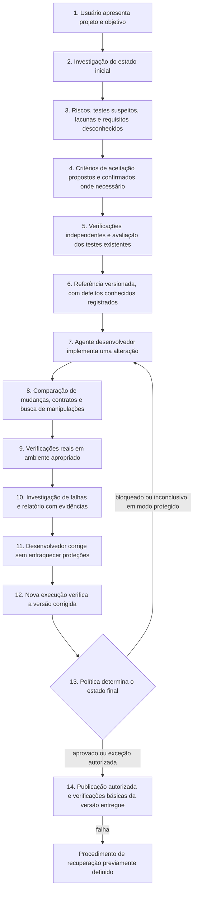

# Fluxo de uso

Os 14 passos da seção 18 do [manifesto](../manifesto.md). É o fluxo proposto, não um fluxo implementado. O manifesto não define qual interface o conduz (veja [PA-06](../perguntas-em-aberto.md)).

## Passos

1. O usuário apresenta o projeto e descreve seu objetivo.
2. O Contraprova investiga o estado inicial sem presumir que esteja correto.
3. Identifica riscos, testes suspeitos, lacunas e requisitos desconhecidos.
4. Propõe critérios de aceitação e solicita confirmação apenas onde necessário.
5. Cria verificações independentes e avalia a eficácia dos testes existentes.
6. Estabelece uma referência versionada, registrando defeitos conhecidos sem legitimá-los.
7. O agente desenvolvedor implementa uma alteração.
8. O Contraprova compara mudanças, verifica contratos e procura manipulações.
9. Executa verificações reais em ambiente apropriado.
10. Investiga falhas e apresenta relatório com evidências.
11. O desenvolvedor corrige os problemas, sem enfraquecer as proteções.
12. Uma nova execução verifica a versão corrigida.
13. A política determina o estado final e, quando integrado, controla a publicação.
14. Após publicação autorizada, verificações básicas confirmam o funcionamento da versão entregue; falhas acionam o procedimento de recuperação previamente definido.

## Diagrama

Observações sobre o diagrama:

- O retorno de "bloqueado ou inconclusivo" ao passo 7 é uma leitura dos passos 10 a 13 combinada com a seção 17 (em modo protegido, esses estados impedem a publicação). O manifesto não desenha o laço explicitamente.
- O passo 13 diz "quando integrado, controla a publicação": em modo consultivo a política determina o estado final, mas apenas recomenda (veja [estados-de-decisao.md](estados-de-decisao.md)).
- A seção 21 pede limites configuráveis para evitar ciclos infinitos de tentativa e erro nas correções assistidas.

## Relação com capacidades

| Passos | Capacidades principais |
|---|---|
| 1 a 3 | [CAP-01, CAP-02](capacidades.md) |
| 4 | [CAP-03](capacidades.md) |
| 5 | [CAP-07, CAP-09](capacidades.md) |
| 6 | [CAP-12](capacidades.md), [CAP-23](capacidades.md) |
| 7 | fora do Contraprova (o agente desenvolvedor) |
| 8 | [CAP-05](capacidades.md) |
| 9 e 12 | [CAP-04](capacidades.md) |
| 10 | [CAP-06, CAP-08](capacidades.md) |
| 11 | fora do Contraprova, salvo correção assistida ([CAP-19](capacidades.md)) |
| 13 | [CAP-25, CAP-14, CAP-15](capacidades.md) |
| 14 | descrito apenas no fluxo; o manifesto não nomeia uma capacidade dedicada |
